# Car Price Prediction: End-to-End ML Regression System

Predict the resale price of a used car in India from its age, mileage, fuel type, transmission,
seller type, ownership history and current ex-showroom price, with a reproducible scikit-learn
pipeline, honest model selection, a validated inference API and a Streamlit app.


**Headline result:** a Random Forest trained on the *share of the new-car price retained*
reaches **R² = 0.954** and **MAE ≈ ₹68,700** on a held-out test set of 40 cars
(cross-validation RMSE 1.05 ± 0.21 lakh on the training set).

---

## Contents
1. [Problem statement](#1-problem-statement)
2. [Objectives](#2-objectives)
3. [Dataset](#3-dataset)
4. [Technology stack](#4-technology-stack)
5. [Project architecture](#5-project-architecture)
6. [Installation](#6-installation)
7. [Data download](#7-data-download)
8. [Training and evaluation](#8-training-and-evaluation)
9. [Results and model comparison](#9-results-and-model-comparison)
10. [Exploratory data analysis](#10-exploratory-data-analysis)
11. [Prediction CLI and Streamlit app](#11-prediction-cli-and-streamlit-app)
12. [Screenshots](#12-screenshots)
13. [Testing and code quality](#13-testing-and-code-quality)
14. [Limitations](#14-limitations)
15. [Future improvements](#15-future-improvements)
16. [License and acknowledgments](#16-license-and-acknowledgments)

---

## 1. Problem statement

Used-car prices are hard for buyers and sellers to judge: the same model can sell for very
different amounts depending on age, usage and specification. Given a car's characteristics,
estimate a fair **selling price (in lakh INR)** by learning from historical listings. This is
a **supervised regression** problem: the target is a continuous amount of money.

## 2. Objectives

- Build a leakage-free preprocessing + modelling pipeline with `Pipeline` and `ColumnTransformer`.
- Compare Linear Regression, Decision Tree, Random Forest and Gradient Boosting under the same
  cross-validation protocol, tune the tree models, and select a winner **without touching the
  test set**.
- Report MAE, MSE, RMSE and R² on a held-out test set.
- Persist the full fitted pipeline and serve it through a validated CLI and a Streamlit app.
- Keep everything reproducible (fixed seeds, pinned versions, checksum-verified data) and tested.

## 3. Dataset

**[Vehicle dataset from CarDekho](https://www.kaggle.com/datasets/nehalbirla/vehicle-dataset-from-cardekho)**
(Kaggle), file `car data.csv`: 301 listings × 9 columns. Full schema, licensing notes and
download options are in **[data/README.md](data/README.md)**.

| Role | Columns |
|---|---|
| **Target** | `Selling_Price`: listed price, lakh INR (1 lakh = ₹1,00,000) |
| Numeric inputs | `Year`, `Present_Price` (current ex-showroom price, lakh INR), `Kms_Driven`, `Owner` |
| Categorical inputs | `Fuel_Type`, `Seller_Type`, `Transmission` |
| Not used as a feature | `Car_Name`: 98 unique values in ~200 rows would be memorised; used only for cleaning |

**Key data-quality finding:** the file is not just cars. **101 of the 301 rows are
motorcycles and scooters** (Bajaj Pulsar, Royal Enfield, Honda Activa, …), stored as one
contiguous block. They are removed, along with 2 exact duplicates, leaving **198 cars**. This
also removes the dataset's most extreme value (a scooter with 500,000 km).

## 4. Technology stack

| Area | Tools |
|---|---|
| Language | Python 3.11+ (developed on 3.12) |
| Data | pandas, NumPy |
| ML | scikit-learn (`Pipeline`, `ColumnTransformer`, `GridSearchCV`, `RandomizedSearchCV`, `RepeatedKFold`, permutation importance) |
| Visualisation | Matplotlib, Seaborn |
| Persistence | joblib |
| App | Streamlit |
| Quality | pytest, ruff, GitHub Actions CI |
| Notebook | Jupyter (`nbformat` / `nbconvert`) |

## 5. Project architecture

```
car-price-prediction/
├── app/
│   └── streamlit_app.py        # UI: loads the saved model, never retrains
├── src/
│   ├── config.py               # paths, column names, seeds (no machine-specific paths)
│   ├── download_data.py        # fetch dataset + SHA-256 verification
│   ├── data_preprocessing.py   # load, validate, clean, feature engineering, ColumnTransformer, split
│   ├── model.py                # CarPriceRegressor: learns on raw / log / ratio target scale
│   ├── eda.py                  # data-quality report + EDA figures (training split only)
│   ├── train.py                # CV comparison, tuning, selection, persistence
│   ├── evaluate.py             # metrics, evaluation plots, feature importance
│   └── predict.py              # load model, validate inputs, predict (library + CLI)
├── tests/                      # 56 pytest tests (unit + integration)
├── notebooks/
│   ├── exploratory_analysis.ipynb   # executed EDA walkthrough (uses src/ functions)
│   └── build_notebook.py            # regenerates the notebook
├── artifacts/                  # metrics.json, comparison tables, figures/ (committed)
├── models/                     # trained model .joblib (git-ignored, reproducible)
├── data/                       # README with source; raw CSV is git-ignored
├── .github/workflows/ci.yml    # lint → tests → download → train → tests → CLI smoke test
├── requirements.txt / requirements-dev.txt / pyproject.toml
└── LICENSE
```

### How a prediction flows

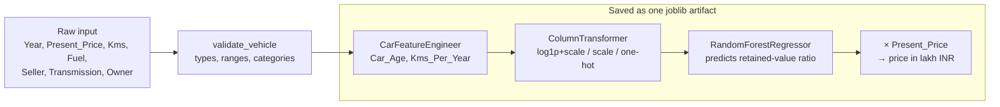

Design decisions worth calling out:

- **Everything that learns from data lives inside the estimator.** The reference year for
  `Car_Age`, the scalers and the one-hot categories are fitted on training folds only. Saving
  that one object means inference replays *exactly* the training-time preprocessing.
- **Target scale is a tuned choice, not an assumption.** `CarPriceRegressor` can learn the raw
  price, `log1p(price)`, or the **ratio `Selling_Price / Present_Price`** (share of value
  retained). Cross-validation picks the best per algorithm (see [§9](#9-results-and-model-comparison)).
  Using `Present_Price` to rescale the target is not leakage, because it is an input known at
  prediction time.
- **Selection uses cross-validation, never the test set.** Hyperparameter search uses one set
  of folds; model selection uses 5×3 repeated K-fold with a different seed; the test set is
  scored once, for reporting.
- **EDA runs on the training split only**, so no modelling choice was informed by test rows.

## 6. Installation

```bash
git clone https://github.com/<your-username>/car-price-prediction.git
cd car-price-prediction
python -m venv .venv
```

Activate the environment:

```bash
# Windows (PowerShell)
.venv\Scripts\Activate.ps1
# macOS / Linux
source .venv/bin/activate
```

Install dependencies (`requirements-dev.txt` adds pytest, ruff and Jupyter tooling):

```bash
pip install -r requirements-dev.txt
```

## 7. Data download

```bash
python -m src.download_data
```

This downloads `car data.csv` to `data/raw/car_data.csv` and verifies its SHA-256. For
the manual Kaggle route see [data/README.md](data/README.md).

## 8. Training and evaluation

```bash
python -m src.eda        # data-quality report + 7 EDA figures  → artifacts/
python -m src.train      # compare, tune, select, evaluate, save → models/, artifacts/
```

`python -m src.train` takes about 75 seconds on a laptop CPU (`--fast` cuts the search
iterations for CI). It writes:

| Output | Contents |
|---|---|
| `models/car_price_model.joblib` | fitted estimator + metadata (feature schema, metrics, versions) |
| `artifacts/metrics.json` | selected model, params, CV / train / test metrics |
| `artifacts/model_comparison.csv` | every model's CV, train and test metrics |
| `artifacts/target_transform_ablation.csv` | CV RMSE of each algorithm × target scale |
| `artifacts/permutation_importance.csv` | test-set permutation importance |
| `artifacts/figures/*.png` | EDA and evaluation plots |

## 9. Results and model comparison

All numbers below come from `artifacts/` after `python -m src.train` with seed 42.
Units: lakh INR (MSE in lakh²). **Selection criterion: lowest mean CV RMSE.**

| Model | Target | CV RMSE (mean ± std) | CV R² | Train RMSE | Test MAE | Test MSE | Test RMSE | Test R² |
|---|---|---|---|---|---|---|---|---|
| **Random Forest** ✅ | ratio | **1.049 ± 0.205** | 0.950 | 0.378 | 0.687 | 0.848 | 0.921 | 0.954 |
| Gradient Boosting | ratio | 1.079 ± 0.286 | 0.949 | 0.389 | 0.662 | 0.621 | 0.788 | 0.966 |
| Linear Regression | ratio | 1.204 ± 0.488 | 0.938 | 1.134 | 0.697 | 0.789 | 0.888 | 0.957 |
| Decision Tree | ratio | 1.574 ± 0.885 | 0.894 | 0.907 | 0.876 | 1.164 | 1.079 | 0.937 |

Selected hyperparameters (Random Forest): `n_estimators=500, max_depth=10, max_features=1.0,
min_samples_leaf=1`.

**How to read this honestly**

- Random Forest and Gradient Boosting are **statistically tied**: their CV gap (0.03 lakh) is
  far smaller than one CV standard deviation. Random Forest wins on mean CV RMSE and has the
  lower variance across folds.
- Gradient Boosting scores better on the *test* set, but choosing it for that reason would
  turn the test set into a validation set and make the reported score optimistic. The
  selection rule was fixed in advance.
- Test RMSE is lower than CV RMSE because the 40-car test set happens to top out at 20.75 lakh,
  while the training folds include the 92.6-lakh Land Cruiser. **The CV estimate (~1.05 lakh)
  is the more realistic expectation.**
- Train RMSE (0.38) vs CV RMSE (1.05) shows the forest still fits the training data closely,
  but CV error is stable across folds, so it generalises acceptably.

### Ablation: what target scale should the model learn?

Mean CV RMSE with default hyperparameters (`artifacts/target_transform_ablation.csv`):

| Model | raw price | log(price) | **ratio = price / new price** |
|---|---|---|---|
| Linear Regression | 2.487 | 1.302 | **1.204** |
| Decision Tree | 2.018 | 2.684 | **1.518** |
| Random Forest | 1.902 | 2.034 | **1.041** |
| Gradient Boosting | 1.849 | 1.929 | **1.111** |

This was the most impactful modelling decision in the project. Predicting **how much of its
new price a car retains** (a number that is roughly 0 to 1 and mostly driven by age) instead of
its absolute price **cut Random Forest error by 45%**. Tree models cannot predict outside the
range of targets they saw in training. On the absolute scale, a validation fold containing the
92.6-lakh Land Cruiser made them fail badly; on the ratio scale that car looks ordinary. The
log target helps the linear model, because depreciation is multiplicative, but it hurts the
trees.

### Evaluation plots

| Actual vs predicted (test) | Residuals |
|---|---|
| 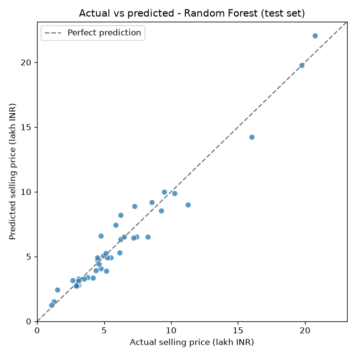 | 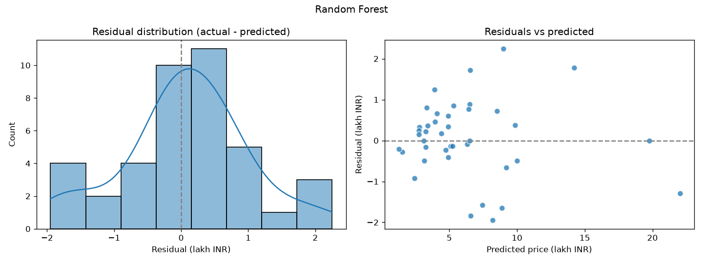 |

Predictions track the diagonal across the price range. Residuals are centred near zero and
mostly fall within ±2 lakh, with no strong funnel shape. The largest absolute errors are on
mid-to-high-priced cars, where there is less training data.

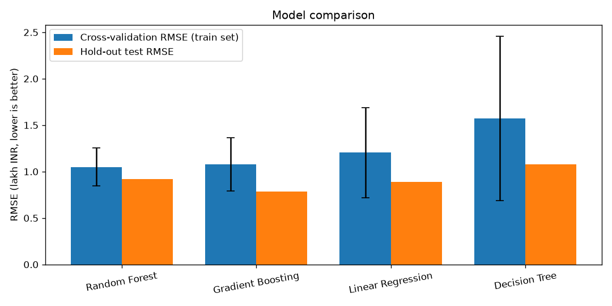

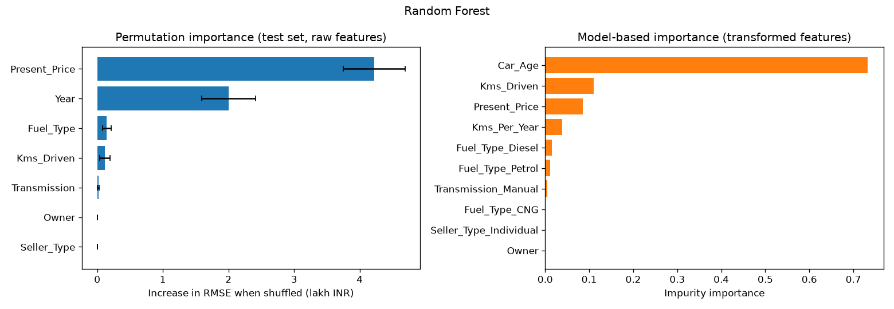

- **Permutation importance** (left; model-agnostic, on raw inputs, test set): shuffling
  `Present_Price` raises RMSE by 4.2 lakh and `Year` by 2.0 lakh; `Fuel_Type` and
  `Kms_Driven` add a little; `Owner` and `Seller_Type` contribute nothing measurable.
- **Impurity importance** (right; inside the forest, which predicts the *ratio*): `Car_Age`
  dominates. These two views are consistent: **age decides what fraction of value is left, and
  the new price sets the scale.**

### Metric definitions

| Metric | Formula | Meaning here |
|---|---|---|
| MAE | mean(\|y − ŷ\|) | average absolute error in lakh: 0.687 ≈ ₹68,700 |
| MSE | mean((y − ŷ)²) | penalises large misses quadratically; units lakh² |
| RMSE | √MSE | same units as price; dominated by the biggest errors |
| R² | 1 − SS_res / SS_tot | share of price variance explained (1.0 = perfect, 0 = predicting the mean) |

## 10. Exploratory data analysis

Figures are generated from the **training split** by `python -m src.eda` and walked through in
[`notebooks/exploratory_analysis.ipynb`](notebooks/exploratory_analysis.ipynb).

| Figure | Insight |
|---|---|
| 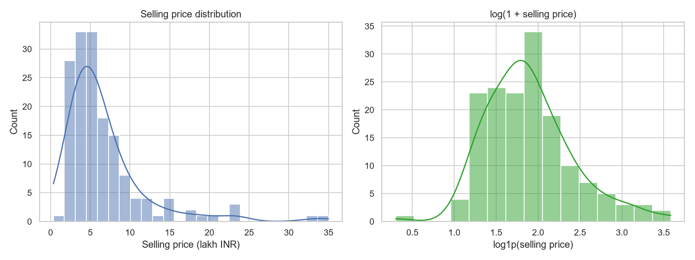 | **Selling price is strongly right-skewed** (skewness 2.79, median 5.25 vs mean 6.68 lakh). `log1p` reduces skewness to 0.70. This motivated evaluating log and ratio targets instead of assuming raw prices behave well. |
| 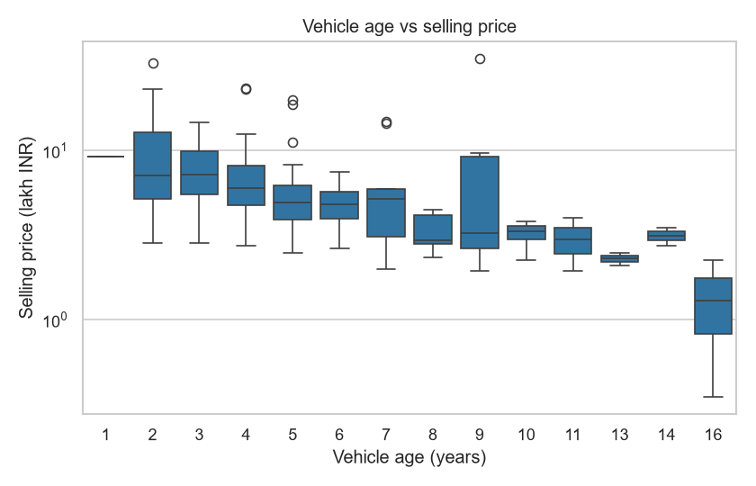 | **Value falls steadily with age.** Median retained value is 83% for cars up to 3 years old, 66% at 4–6 years, 45% at 7–10 years and 26% beyond 10. That clear, roughly multiplicative curve is why `Car_Age` is engineered explicitly. |
| 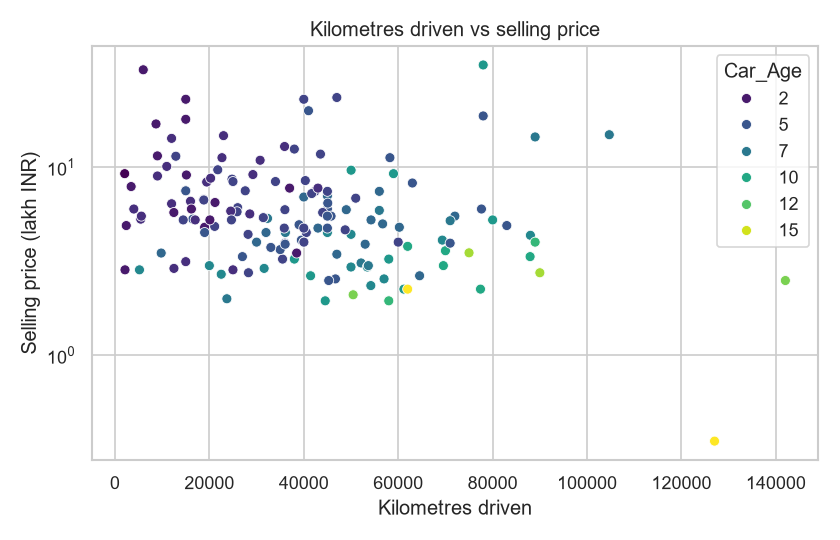 | **Mileage alone is a weak signal** (Spearman −0.28) and is entangled with age: older cars have driven more. Colouring by age shows most of the trend is age. Hence `Kms_Per_Year` (usage intensity) as an extra feature. |
| 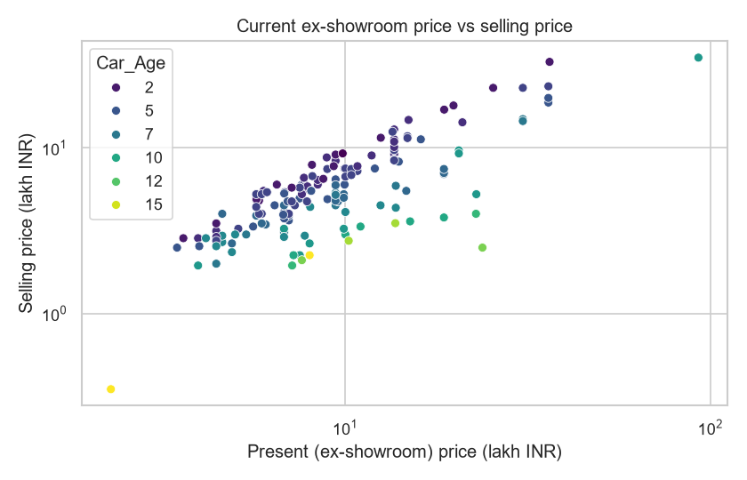 | **New price is the strongest predictor** (Spearman 0.71). On log-log axes, cars of the same age form near-parallel lines, i.e. selling price ≈ new price × an age-dependent factor. This is the observation behind the ratio target. |
| 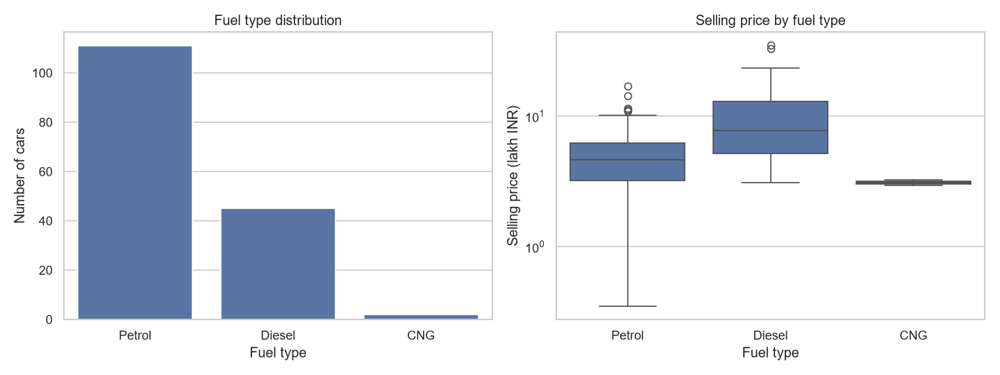 | **Petrol dominates (111 of 158 training cars)**, diesel 45 and CNG only 2. Diesels sell higher (median 7.75 vs 4.65 lakh), partly because diesel variants are pricier new. CNG is too rare to learn from reliably. |
| 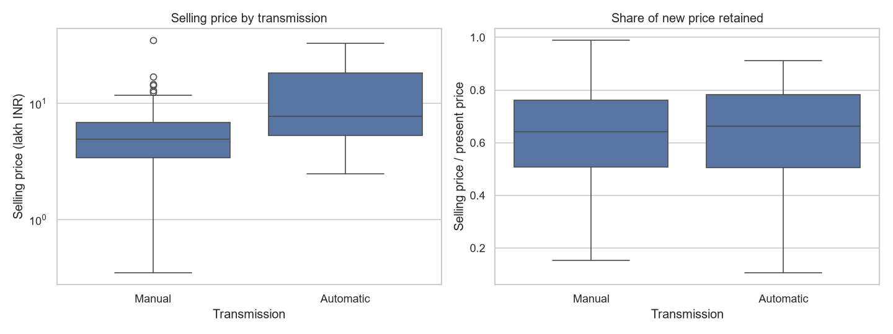 | **Automatics sell for more (median 7.75 vs 4.95 lakh) but retain almost the same share of their new price (66% vs 64%).** The automatic "premium" mostly reflects more expensive models, not slower depreciation. A good example of a confounder. |
| 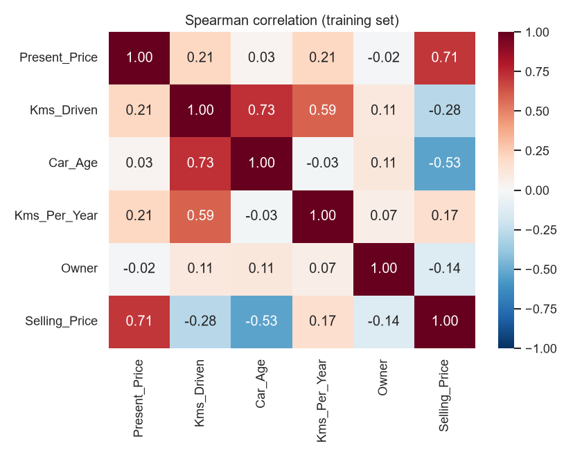 | Spearman correlations confirm the ranking: `Present_Price` (+0.71) > `Car_Age` (−0.53) > `Kms_Driven` (−0.28). `Car_Age` and `Kms_Driven` are strongly correlated with each other (+0.73), so linear coefficients for them should not be interpreted in isolation. |

Feature importance plots are produced after training (see [§9](#9-results-and-model-comparison)).

## 11. Prediction CLI and Streamlit app

### CLI

```bash
python -m src.predict --year 2015 --present-price 9.5 --kms 40000 --fuel Petrol --seller Dealer --transmission Manual --owner 0
```

```
Estimated selling price: ₹6,10,200 (6.10 lakh) [Random Forest]
```

Invalid input is reported field by field (exit code 2), never as a stack trace:

```
Invalid input:
  - 'Kms_Driven' must be a number, got 'abc'.
  - 'Year' must be between 1980 and 2019 (the model's data snapshot year), got 2030.
  - 'Present_Price' (ex-showroom price, lakh INR) must be greater than 0.
  - 'Fuel_Type' must be one of ['CNG', 'Diesel', 'Petrol'], got 'Electric'.
```

Values that are possible but outside the training range (e.g. a 150-lakh car) still get a
prediction, plus a warning that it is an extrapolation.

### Python API

```python
from src.predict import load_model, predict_price, format_inr

bundle = load_model()
result = predict_price({"Year": 2015, "Present_Price": 9.5, "Kms_Driven": 40000,
                        "Fuel_Type": "Petrol", "Seller_Type": "Dealer",
                        "Transmission": "Manual", "Owner": 0}, bundle)
print(format_inr(result.price_inr), result.warnings)
```

### Streamlit app

```bash
streamlit run app/streamlit_app.py
```

Then open <http://localhost:8501>. The app:

- loads the saved model once (`st.cache_resource`), so it **never retrains**;
- offers year, ex-showroom price, kilometres, fuel, seller, transmission and owner inputs, with
  dropdown options taken from the categories the model was trained on;
- shows the estimate in INR with Indian digit grouping (₹5,09,590), the share of new price
  retained, and a typical-error band based on test MAE;
- shows validation errors and extrapolation warnings clearly;
- has a **Model performance** tab with the comparison table and evaluation plots.

If no model has been trained yet, the app explains how to train one instead of crashing.

> **Why does the app ask for the ex-showroom price?** It is the single most informative input:
> it tells the model which segment the car belongs to (a hatchback versus an SUV). Without it,
> the dataset's other columns cannot distinguish a 4-lakh car from a 30-lakh one.

## 12. Screenshots

**Predict tab:** vehicle form, the estimate in ₹ with Indian digit grouping, the share of
new price retained, and a typical-error band. The sidebar shows the selected model and its
held-out test metrics.

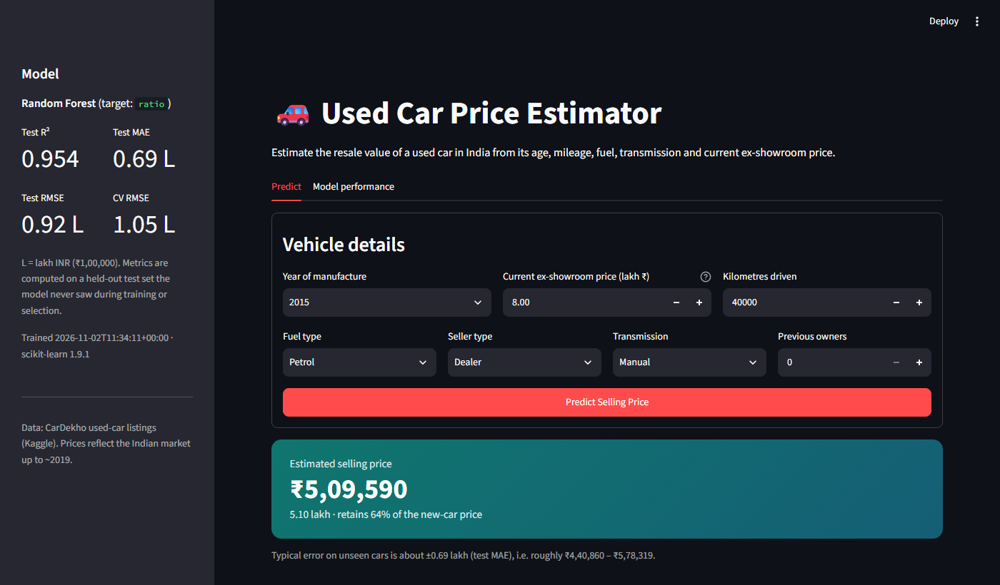

**Model performance tab:** the comparison table and evaluation plots, read from `artifacts/`.

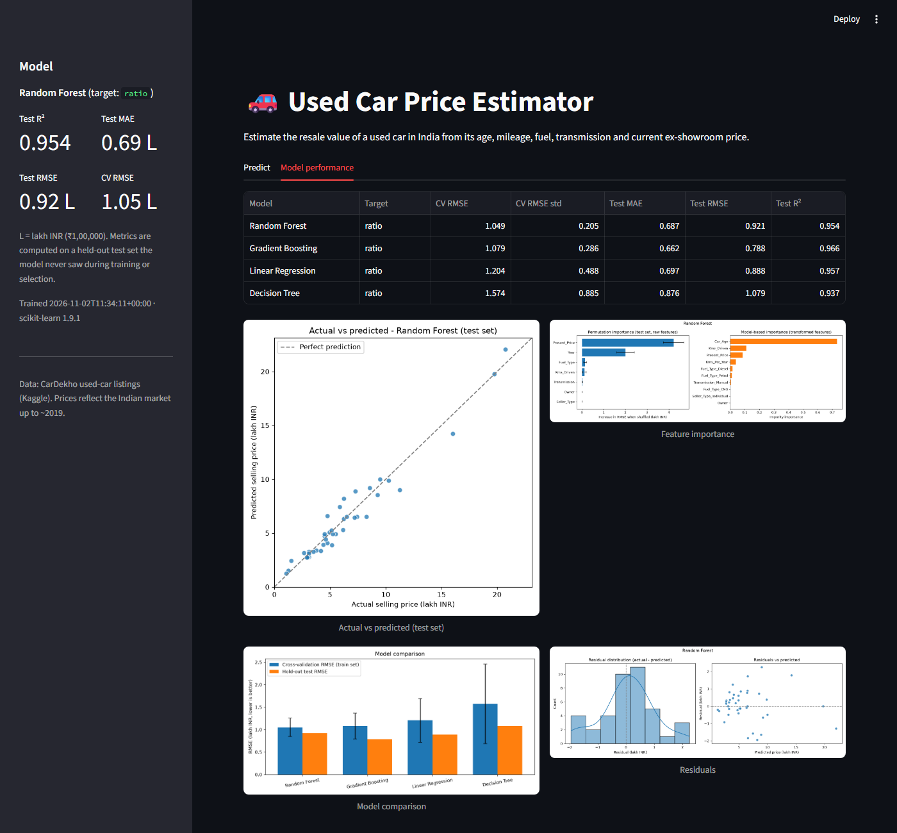

## 13. Testing and code quality

```bash
pytest -q
ruff check src app tests
```

**56 tests** cover:

- **Preprocessing:** schema validation, non-numeric values, missing values, duplicate and
  two-wheeler removal, whitespace normalisation.
- **Feature engineering:** age and usage maths, reference year learned from training data only,
  clipping of future years, unfitted-transformer errors.
- **Leakage / pipeline consistency:** scaler statistics equal *training-split* statistics;
  stratified split is disjoint and reproducible; unseen categories do not crash.
- **Model wrapper:** every target mode predicts on the price scale; ratio decoding; `clone` and
  `GridSearchCV` compatibility.
- **Persistence:** save → load gives bit-identical predictions; missing, corrupt and foreign
  files raise clear `ModelLoadError`s.
- **Input validation:** every missing field, wrong types, NaN, booleans, out-of-range values,
  unknown categories, all errors reported together, out-of-range warnings.
- **Inference:** positive float output, newer car ≥ older car, batch matches single
  predictions, INR formatting, CLI exit codes.
- **Integration** (auto-skipped on a fresh clone): real dataset shape and cleaning counts; the
  trained model bundle's schema and a sanity-check prediction.

Unit tests use a small synthetic fixture with the real schema, so they run in about 3 seconds
without the dataset. As a check that the tests have teeth, two deliberately injected bugs (an
off-by-one reference year, and a broken ratio decoding) made 3 and 9 tests fail respectively.

CI (`.github/workflows/ci.yml`) runs lint → unit tests → data download → fast training → full
tests → CLI smoke test on every push.

## 14. Limitations

- **Small dataset.** 198 cars (158 train / 40 test). A 40-car test set gives a noisy estimate;
  this is why CV mean ± std is reported alongside test scores.
- **Old snapshot.** Listings run up to model year 2018 (the model's reference year is 2019).
  Prices do not reflect post-2019 market changes (inflation, the pandemic used-car spike, new
  models), so absolute estimates for today's market will be low.
- **Narrow coverage.** CNG (2 cars), individual sellers (5), and cars with previous owners (5)
  are too rare for the model to learn their effect. `Owner` and `Seller_Type` show ~0
  importance for this reason, not because they never matter.
- **Missing drivers of price:** brand, model variant, condition, accident history, city,
  service records. `Present_Price` acts as a proxy for brand and segment only.
- **Extrapolation.** Inputs outside the training ranges (e.g. new price > 92.6 lakh) are
  accepted with a warning; treat such estimates with caution.
- **Two-wheeler filter is rule-based** (brand keywords on `Car_Name`). It matches this file
  exactly (101 rows, one contiguous block) but would need revisiting for a different dataset.
- **Point estimates only.** The app's "typical error" band is the test MAE, not a calibrated
  prediction interval.

## 15. Future improvements

- **More and fresher data**, e.g. the larger CarDekho `Car details v3.csv` (~8,000 rows, with
  brand, engine and mileage), and a time-aware split so the model is tested on newer listings.
- **Brand/model features** with target encoding fitted inside CV folds.
- **Prediction intervals** via quantile gradient boosting or conformal prediction.
- **Nested cross-validation** for a fully unbiased estimate of the tuned models.
- **Monotonic constraints** (e.g. `HistGradientBoostingRegressor(monotonic_cst=...)`) so price
  never increases with age or mileage.
- **Serving:** a FastAPI endpoint, a Dockerfile, and model versioning with MLflow.

## 16. License and acknowledgments

- Code: [MIT License](LICENSE).
- Data: CarDekho vehicle dataset from Kaggle (`nehalbirla/vehicle-dataset-from-cardekho`). It
  is not redistributed here; see its Kaggle page for license terms.
- Built with scikit-learn, pandas, NumPy, Matplotlib, Seaborn and Streamlit.
